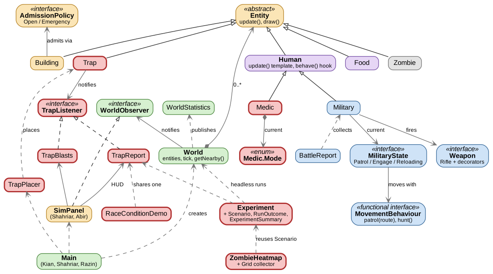
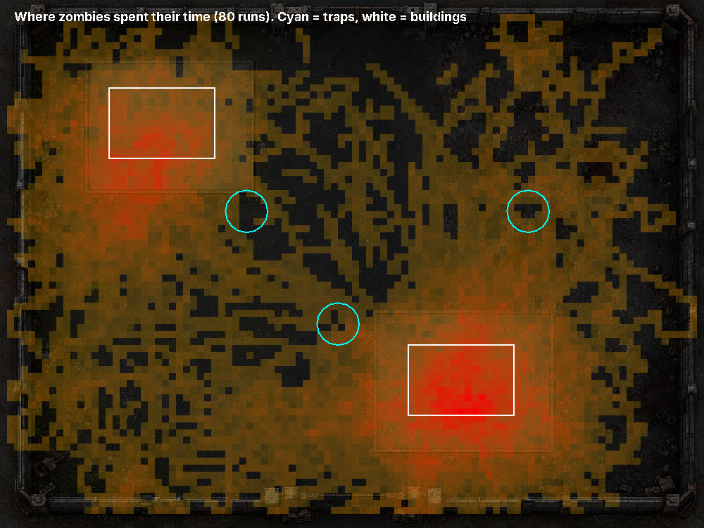
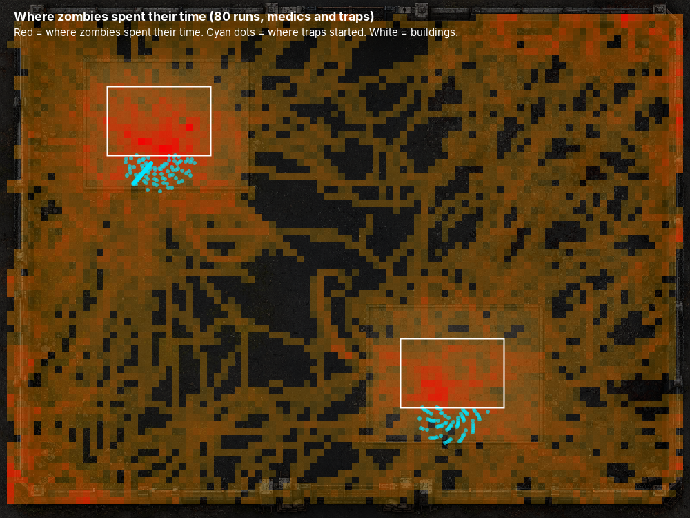

# Git Wreckers : Zombie Mission Simulation  

## Overview
What happens when a group of zombie infections spreads through a living community? Git Wreckers explores this through a 2D zombie outbreak simulation developed in Java, where humans search for food and shelter while zombies hunt and infect humans and military units attempt to control the outbreak. Without direct player control, the interactions between agents can create unexpected outcomes such as large outbreaks or naturally formed safe zones.

## Project Concepts
- **Zombies** pursue nearby humans and infect on contact
- **Humans** move, seek shelter, consume food, and become inactive when they starve
- **Military** patrol and can kill zombies
- **Medics** heal injured civilians nearby, and **traps** catch zombies that walk over them
- Behaviour emerges from local agent interactions
- **No player input.** Every agent follows simple local rules, so the outbreak curve and the formation of safe zones emerge from the interactions themselves

## Features
- World simulation
- Tick Loop
- Human movement and survival
- Zombie infection and chasing
- Military patrol and shooting
- Buildings and shelter
- Food/resources
- Population statistics
- Start, pause, reset, and speed controls
- Medics that heal civilians, traps that catch zombies, and a button to place extra traps
- Tools that run the simulation without a window: an experiment comparing scenarios, a zombie heatmap, and a race condition demo

## Class Structures

The main classes in this fork and how they connect. Colours show who wrote each class: red is mine (Abyad Razin), blue Neev, green Kian, yellow Shahriar, purple Abir, grey Nick. Hollow triangles mean "extends" (dashed: "implements").



The team's original plan is in the [team UML diagram](https://drive.google.com/file/d/1-3FDkD7lQL_UJ8YTpuyqcfL1BkNXXclc/view?usp=sharing).

### Design patterns in this fork

| Pattern | Where | Written by |
|---|---|---|
| Template Method | `Human.update()` fixes the order of every tick and calls the `behave()` step, which `Medic` overrides | Abyad Razin (split of Abir's `Human`) |
| Observer | `Trap` tells every `TrapListener` (`TrapReport`, `TrapBlasts`) about each catch | Abyad Razin |
| State | `Medic.Mode`: each mode carries its behaviour as a lambda, and `Medic.decideMode()` picks one each tick | Abyad Razin |
| Strategy (lambdas) | `Experiment.Scenario`: each scenario is a `Predicate<Entity>` choosing which entities to keep | Abyad Razin |
| Observer | `World` publishes an immutable `WorldStatistics` to each `WorldObserver` (`SimPanel`) after every tick | Kian |
| Strategy | `Building` asks its `AdmissionPolicy` (`OpenAdmissionPolicy`, `EmergencyAdmissionPolicy`) who may shelter | Shahriar |
| State | `Military` hands its turn to a `MilitaryState` (`PatrolState`, `EngageState`, `ReloadingState`) | Neev |
| Strategy (lambdas) | `MovementBehaviour.patrol()` and `hunt()` return lambdas | Neev |
| Decorator | `Weapon` upgrades: `Rifle` wrapped by `ScopeDecorator` and `ExtendedMagazineDecorator` | Neev |
| Iterator | `PatrolRoute.cycle()` returns an endless `Iterator<Point2D>` over the waypoints | Neev |

The generic design is demonstrated by `Human.findNearestEntity()`, which searches for the nearest entity of a requested subtype. The Food constructor uses the standard `double` type because it already accepts both integer and decimal literals.

## Team Responsibilities
Use the agreed division:

| Area | Responsibility | Member | Student ID |
|---|---|---|---|
| World/Main | Tick loop, spawning, and neighbour queries | Tran Khoi Nguyen (Kian) Nguyen | 48769266 |
| Human/Food | Energy, starvation, food consumption, and shelter | Abir Maya Bhowmick | 49125761 |
| Zombie | Infection, chasing, and target selection | Nicholas Fang | |
| Military/MovementBehaviour | Patrol, shooting, and strategy pattern | Neev Patel | 48521558 |
| Building/SimPanel | Occupancy, rendering, and statistics | Shahriar Hasan | |
| Medic/Trap | Healing civilians, traps that catch zombies, and trap events | Abyad Razin | 61216542 |

## Rules 
- Zombies chase nearby humans.
- Humans attempt to survive by moving, finding food, and seeking shelter. They lose energy on each update, gain energy by eating nearby food, and become inactive when their energy reaches zero.
- Zombies infect humans when they catch them.
- Military units patrol and shoot zombies.
- Medics heal the weakest visible civilian within 300 units (30 energy, then a 15-tick cooldown), but only while their own energy is above 35 and no zombie is within 100 units of them or the patient.
- Traps catch any zombie within 18 units. Each trap has 2 uses and breaks when they run out. Three start near building doors, and up to three more can be placed by hand.
- The simulation progresses automatically through repeated ticks.
- Population changes are caused by interactions between entities.

## Requirements
- Git
- Java Development Kit (JDK 17 or later)

### How to run
1. Clone this project and move to this project
```bash
git clone https://github.com/AbyadRazin/Git-Wreckers-on-a-Zombie-mission

cd Git-Wreckers-on-a-Zombie-mission
cd COMP2000
```
2. Compile the Java source files.
```bash
javac -d out src/*.java
```

3. Run the `Main` class
```bash
java -cp "out;src" Main
```

On macOS or Linux, use a colon instead of a semicolon: `java -cp "out:src" Main`.
The `src` entry makes the PNG image assets available at runtime.

4. Check the Java version and confirm that the image folders are present.
```bash 
java -version
javac -version
```

### Running the tests
Each test class has its own `main` method. Compile the tests together with the source, then run any of them from the `COMP2000` folder:
```bash
javac -d out src/*.java test/*.java
java -cp "out:src" MedicTest
```
GitHub Actions compiles the project and runs the tests on every push and pull request.

## My additions (Abyad Razin, Person F)

This fork is my individual submission. On top of the team's simulation I built the Medic and the Trap, and then measured whether they actually help.

| Part | What it does | Main ideas |
|---|---|---|
| `Medic` | Heals the most urgent visible civilian nearby, skips patients with a zombie close by, and shows its current mode above its head | Template Method (`Human.update()` fixes the energy step, `behave()` is overridden), State pattern (`Medic.Mode` enum, each mode carries its behaviour as a lambda), streams to choose the patient |
| `Trap` | Catches zombies that walk over it, with limited uses; starting traps go at random spots in front of the building doors | Streams, exceptions for invalid traps and when there's no free spot |
| Trap events | Every catch is announced to listeners: a HUD counter (`TrapReport`), a blast effect (`TrapBlasts`), and the experiment | Observer pattern (`TrapListener`) |
| Place-a-trap button | Press the button, then click the map to place up to 3 extra traps | `TrapPlacer`, a lambda callback for the map click |
| `Experiment` | Runs the simulation hundreds of times without a window to compare no additions, traps only, medics only, and both, on the same starting layouts | Parallel stream, custom `Collector` with a standard error, `partitioningBy`, a lambda per scenario instead of a class per scenario |
| `ZombieHeatmap` | Records where zombies spend their time and draws it as a picture | Parallel runs, each with its own grid, merged by a custom `Collector` |
| `RaceConditionDemo` | Shows what goes wrong if parallel runs share one counter, against an atomic counter and one counter per run | Race conditions, thread confinement |

Run them after compiling (step 2 above), from the `COMP2000` folder:

```bash
java -cp "out:src" Experiment 200 1500        # runs per scenario, ticks per run
java -cp "out:src" ZombieHeatmap 80 1500 heatmap.png
java -cp "out:src" RaceConditionDemo
```

The heatmap is what moved the traps. Zombies crowd around the building doors because survivors run there to shelter, while my original fixed traps sat in quiet gaps:

| Before: fixed traps (cyan rings) | After: traps start at the doors (cyan dots) |
|---|---|
|  |  |

Latest experiment results, with the exact command to reproduce them: [docs/results/experiment-2026-11-09.txt](docs/results/experiment-2026-11-09.txt). With medics and traps together, 10.23 civilians survive on average against 8.71 with neither.

My tests: `MedicTest`, `TrapPlacerTest`, `TrapEventsTest`, `TrapPlacementTest`, `ExperimentTest`, `RaceConditionDemoTest`, `ZombieHeatmapTest`.

## References
- COMP2000 course materials
- Image assets are the PNG files included in this repository under `COMP2000/src/assets`, one folder per kind of thing (`world`, `human`, `medic`, `military`, `zombie`, `food`, `trap`).
- The simulation loads these assets from the classpath; no external image source or attribution is recorded in the submitted project.
